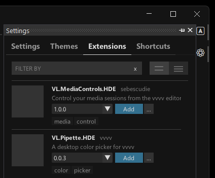

# Extensions

Editor extensions are little tools that can be installed to enhance vvvv. Use the "Extensions" tab in the [Settings](settings.md) to browse and install them. 

## Creating extensions

Extensions are only patches, so it is easy to create your own. See [Creating Editor Extensions](../extending/editor-extensions.md).