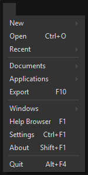
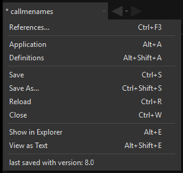
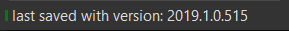
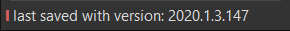
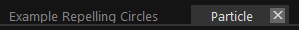
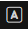
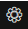

# Overview

## The Quad menu
The Quad menu collects all global commands.

It gives you quick access to:
- Recent Sketches: For quickly accessing most recent .vl documents you've been working on
- Documents: A listing of all currently open .vl documents
- Applications: A listing of all currently open main entry points
- [Exporting Applications](exporting.md)
- Windows, like [Extensions](extensions.md), the [Documentation Window](documentation.md) and the [Solution Explorer](solution-explorer.md)
- [The Help Browser](findinghelp.md#help-browser)
- [The Settings](settings.md)

## The document menu
The document menu collects all commands relevant for the active document.

It gives you quick access to:
- The documents [References](packman.md)
- The documents [application patch](../language/patches.md#application-patch)
- The documents [definition patch](../language/patches.md#definitions-patch)
- Saving, reloading, closing the document
- Jumping to the document in the Explorer
  
### Last saved with version
At the bottom of the document menu you see the VL version the document was last saved with. If there is a little green or red icon before the document name, this means that the document has been saved with a version different to the one currently running.

*Green* 

A little green symbol next to the document's name is a hint that the document was upgraded to the currently running version, which is usually just fine. Still this hint is given so you know that if you save the document in this version it may have troubles being loaded in an older version.

*Red*

A red symbol is a warning that the document was last saved with a newer version and therefore things may not look/work as expected. In that case consider running a newer version of VL to open this document.
  
## Document Tabs

Shows titles of all open patches.

## About

Can be invoked via <kbd>Shift</kbd><kbd>F1</kbd>

- The About dialog including 
  - Version and licensing info for vvvv itself and all used open source libraries
  - Links to this documentation, the [Changelog](../../changelog/index.md) and [Roadmap](../../roadmap/index.md)
- Licensing Terms including a link to the [vvvv License Store](https://store.vvvv.org)

## Settings

Can be invoked via <kbd>Ctrl</kbd><kbd>F1</kbd>

Gives you quick access to: 
- [Settings](settings.md)
- [Themes](themes.md)